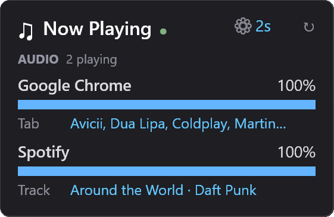

# Now Playing — Rainmeter Widget

A Rainmeter widget that lists the applications playing audio right now, and what each one is
playing: the track, the browser tab, or the window. Click a row to go straight to it.



---

## What it shows

One row per app making sound, with its volume in the Windows mixer and a line saying what it plays:

| Label | Source |
| --- | --- |
| `Track` | Title and artist from the Windows media controls, the same feed as the volume flyout (Spotify, most players) |
| `Tab` | For browsers: the playing tab's media title, or the title of the tab Chrome marks as *Audio playing* |
| `Media` | A media session with a title but no artist |
| `Window` | The window title, for apps that publish no media info |

"Playing" means the app's peak meter went above -40 dBFS, which you can clearly hear. Near-silent
streams don't count. A row stays for 6 seconds after its app goes quiet, drawn dim, so pauses
between songs don't make it flicker. An app muted in the mixer shows `muted` in amber.

**Click a row** to bring that app forward, restoring it if minimized. For a Chromium browser it
first switches to the tab making the sound, even if it's in another window or isn't the active
tab.

The dot next to the title is green while the watcher is running, and red if it stops or reports
an error. Hover over it for the reason.

---

## Requirements

- Windows 10 or later
- [Rainmeter](https://www.rainmeter.net/) 4.5+
- Windows PowerShell 5.1, which ships with Windows

---

## Installation

### From the packaged skin

1. Download the `.rmskin` from [Releases](../../releases).
2. Double-click it. Rainmeter installs and loads the skin.

### Manual

1. Copy `Skins/NowPlaying` into your Rainmeter skins folder. The exact path is whatever
   `SkinPath` says in `%APPDATA%\Rainmeter\Rainmeter.ini`, commonly
   `%USERPROFILE%\Documents\Rainmeter\Skins\`. It follows a redirected Documents folder
   (OneDrive, for instance).
2. Right-click the Rainmeter tray icon → **Refresh all**.
3. Right-click the tray icon → **Skins → NowPlaying → NowPlaying.ini**.

### Building the `.rmskin` yourself

```powershell
.\build.ps1
```

A `.rmskin` is a ZIP with a 16-byte trailer: an int64 of the ZIP length, a flags byte, then
`RMSKIN\0`. Zipping the folder by hand produces a package Rainmeter rejects, so `build.ps1`
writes the trailer.

---

## Configuration

Click the gear (or right-click the widget) for the refresh interval (1 / 2 / 5 / 10 s) and size
(100–250%) presets.

Everything else lives in `Skins/NowPlaying/@Resources/Variables.inc`:

| Variable | Purpose |
| --- | --- |
| `Scale` | Master zoom. `1` is the original size, `2` is double. Decimals work. |
| `RefreshInterval` | Seconds between snapshots. Default 2. |
| `HoldSeconds` | How long a quiet app stays listed. Default 6. |
| `MaxSlots` | Rows the skin has room for (6). Raising it also needs more slot blocks in `NowPlaying.ini`. |
| Colour variables | Background, text, bars, row hover. |

---

## How it works

`Get-NowPlaying.ps1` is one long-running PowerShell loop, started by the skin:

1. It lists the Core Audio sessions on every active output device and samples their peak meters
   ten times a second, in compiled C#.
2. Every `RefreshInterval` seconds, it groups the sessions by process name (browsers and chat
   apps play through helper processes, often one session per device), matches them to the
   playing media sessions, and writes `%APPDATA%\NowPlaying\now.txt`.
3. The skin reads that file every second with WebParser. It's `key=value` lines, not JSON,
   because titles are full of quotes.

Chrome reports only **one** media session to Windows: the tab that made sound most recently. A
notification ping in another tab takes that slot from a video that has been playing for an hour.
So for browsers, the widget also reads the tab strip through UI Automation, where the tab making
sound is named `<title> - Audio playing`. That's also how a click switches to the right tab
(`BrowserTabs.ps1`, `Focus-App.ps1`).

Refreshing the skin starts a new copy of the loop that tells the old one to stop, so only one
runs. The loop exits when Rainmeter closes. It uses about 3% of one CPU core.

---

## Limits

- The *Audio playing* mark is the browser's English UI text. In another UI language, or in
  Firefox, which doesn't expose it, rows fall back to the window title and clicks go to the
  window.
- If two tabs play at once, the first one found wins.
- Sound routed through another app (a virtual mixer, for instance) is listed under that app.
- Each click starts a short PowerShell helper, so switching takes about half a second.

---

## License

MIT, see [LICENSE](LICENSE).
